# Modelo de datos de la oposición (SQLite)

Base de datos: `oposicion.db` · 27 tablas.

## Relaciones (claves foráneas)

| Tabla origen | Campo | Tabla destino | Campo |
|---|---|---|---|
| `concepto_fragmentos` | `concepto_id` | `conceptos` | `id` |
| `concepto_fragmentos` | `fragmento_id` | `fragmentos` | `id` |
| `concepto_temas` | `concepto_id` | `conceptos` | `id` |
| `concepto_temas` | `tema_id` | `temas` | `id` |
| `conceptos_candidatos` | `concepto_promovido_id` | `conceptos` | `id` |
| `conceptos_candidatos` | `tema_id` | `temas` | `id` |
| `cuadro_filas` | `cuadro_id` | `cuadros` | `id` |
| `cuadros` | `tema_id` | `temas` | `id` |
| `esquemas` | `tema_id` | `temas` | `id` |
| `examen_preguntas` | `examen_id` | `examenes` | `id` |
| `examen_resultados` | `examen_id` | `examenes` | `id` |
| `examen_stats_concepto` | `concepto_id` | `conceptos` | `id` |
| `examen_stats_concepto` | `examen_id` | `examenes` | `id` |
| `examen_stats_tema` | `examen_id` | `examenes` | `id` |
| `examen_stats_tema` | `tema_id` | `temas` | `id` |
| `flashcards` | `concepto_id` | `conceptos` | `id` |
| `flashcards` | `tema_id` | `temas` | `id` |
| `fragmentos` | `fuente_id` | `fuentes` | `id` |
| `fragmentos` | `tema_id` | `temas` | `id` |
| `pregunta_reuso` | `pregunta_id` | `preguntas` | `id` |
| `preguntas` | `concepto_id` | `conceptos` | `id` |
| `preguntas` | `tema_id` | `temas` | `id` |
| `srs_historial` | `item_key` | `srs_items` | `item_key` |
| `supuesto_artefactos` | `supuesto_id` | `supuestos` | `id` |
| `supuesto_preguntas` | `pregunta_id` | `preguntas` | `id` |
| `supuesto_preguntas` | `supuesto_id` | `supuestos` | `id` |
| `supuesto_temas` | `supuesto_id` | `supuestos` | `id` |
| `supuesto_temas` | `tema_id` | `temas` | `id` |
| `supuestos` | `bloque_id` | `bloques` | `id` |
| `temas` | `bloque_id` | `bloques` | `id` |
| `test_practica_preguntas` | `pregunta_id` | `preguntas` | `id` |
| `test_practica_preguntas` | `test_id` | `tests_practica` | `id` |

## Tablas y campos

### `bloques` (4 filas)

| Campo | Tipo | PK | NOT NULL | Default |
|---|---|---|---|---|
| `id` | TEXT | ✓ |  |  |
| `numero` | INTEGER |  | ✓ |  |
| `nombre` | TEXT |  | ✓ |  |
| `descripcion` | TEXT |  |  |  |
| `tiene_supuestos` | BOOLEAN |  |  | 0 |

### `concepto_fragmentos` (5 filas)

| Campo | Tipo | PK | NOT NULL | Default |
|---|---|---|---|---|
| `concepto_id` | TEXT | ✓ | ✓ |  |
| `fragmento_id` | TEXT | ✓ | ✓ |  |
| `es_principal` | BOOLEAN |  |  | 0 |
| `aportacion` | TEXT |  |  |  |
| `fecha_vinculo` | TEXT |  | ✓ |  |

### `concepto_temas` (1520 filas)

| Campo | Tipo | PK | NOT NULL | Default |
|---|---|---|---|---|
| `concepto_id` | TEXT | ✓ | ✓ |  |
| `tema_id` | TEXT | ✓ | ✓ |  |
| `es_principal` | BOOLEAN |  |  | 0 |

### `conceptos` (1512 filas)

| Campo | Tipo | PK | NOT NULL | Default |
|---|---|---|---|---|
| `id` | TEXT | ✓ |  |  |
| `nombre` | TEXT |  | ✓ |  |
| `tipo` | TEXT |  |  |  |
| `valor` | TEXT |  |  |  |
| `norma` | TEXT |  |  |  |
| `articulo` | TEXT |  |  |  |
| `tags` | TEXT |  |  |  |
| `verificado` | BOOLEAN |  |  | 0 |
| `es_semilla` | BOOLEAN |  |  | 0 |
| `resumen` | TEXT |  |  |  |
| `completitud` | REAL |  |  | 0 |
| `fuentes_count` | INTEGER |  |  | 0 |
| `ultima_actualizacion` | TEXT |  |  |  |
| `discrepancia` | INTEGER |  |  | 0 |
| `fusionado_en` | TEXT |  |  |  |
| `es_core` | BOOLEAN |  |  | 0 |

### `conceptos_candidatos` (72 filas)

| Campo | Tipo | PK | NOT NULL | Default |
|---|---|---|---|---|
| `id` | INTEGER | ✓ |  |  |
| `tema_id` | TEXT |  | ✓ |  |
| `nombre` | TEXT |  | ✓ |  |
| `descripcion` | TEXT |  |  |  |
| `n_fragmentos` | INTEGER |  |  | 0 |
| `fragmento_ids` | TEXT |  |  | '[]' |
| `estado` | TEXT |  | ✓ | 'pendiente' |
| `primera_aparicion` | TEXT |  | ✓ |  |
| `ultima_actualizacion` | TEXT |  | ✓ |  |
| `concepto_promovido_id` | TEXT |  |  |  |

### `cuadro_filas` (35 filas)

| Campo | Tipo | PK | NOT NULL | Default |
|---|---|---|---|---|
| `id` | TEXT | ✓ |  |  |
| `cuadro_id` | TEXT |  | ✓ |  |
| `fuente` | TEXT |  |  |  |
| `fuente_tipo` | TEXT |  |  |  |
| `valores` | TEXT |  | ✓ |  |
| `pasaje_origen` | TEXT |  |  |  |
| `ubicacion` | TEXT |  |  |  |
| `verificado` | BOOLEAN |  |  | 0 |

### `cuadros` (6 filas)

| Campo | Tipo | PK | NOT NULL | Default |
|---|---|---|---|---|
| `id` | TEXT | ✓ |  |  |
| `tema_id` | TEXT |  |  |  |
| `tipo_dato` | TEXT |  | ✓ |  |
| `titulo` | TEXT |  | ✓ |  |
| `semilla` | BOOLEAN |  |  | 0 |
| `n_filas` | INTEGER |  |  | 0 |
| `n_fuentes_distintas` | INTEGER |  |  | 0 |
| `columnas` | TEXT |  | ✓ |  |
| `columna_clave` | TEXT |  |  |  |
| `columna_respuesta` | TEXT |  |  |  |
| `columna_contexto` | TEXT |  |  |  |
| `columna_fuente` | TEXT |  |  |  |
| `verificado` | BOOLEAN |  |  | 0 |

### `esquemas` (1 filas)

| Campo | Tipo | PK | NOT NULL | Default |
|---|---|---|---|---|
| `id` | TEXT | ✓ |  |  |
| `tema_id` | TEXT |  |  |  |
| `formato` | TEXT |  | ✓ |  |
| `seleccion_modo` | TEXT |  |  |  |
| `seleccion_valor` | TEXT |  |  |  |
| `contenido` | TEXT |  | ✓ |  |
| `n_nodos` | INTEGER |  |  |  |
| `verificado` | BOOLEAN |  |  | 0 |

### `examen_preguntas` (870 filas)

| Campo | Tipo | PK | NOT NULL | Default |
|---|---|---|---|---|
| `examen_id` | TEXT | ✓ | ✓ |  |
| `pregunta_id` | TEXT |  | ✓ |  |
| `seccion` | TEXT | ✓ | ✓ |  |
| `numero` | INTEGER | ✓ | ✓ |  |
| `respuesta_oficial` | TEXT |  |  |  |
| `tema_id` | TEXT |  |  |  |

### `examen_resultados` (0 filas)

| Campo | Tipo | PK | NOT NULL | Default |
|---|---|---|---|---|
| `examen_id` | TEXT | ✓ | ✓ |  |
| `fecha` | TEXT | ✓ | ✓ |  |
| `puntuacion` | INTEGER |  |  |  |
| `por_bloque` | TEXT |  |  |  |
| `por_seccion` | TEXT |  |  |  |

### `examen_stats_concepto` (866 filas)

| Campo | Tipo | PK | NOT NULL | Default |
|---|---|---|---|---|
| `examen_id` | TEXT | ✓ | ✓ |  |
| `concepto_id` | TEXT | ✓ | ✓ |  |
| `n_preguntas` | INTEGER |  | ✓ | 0 |

### `examen_stats_tema` (318 filas)

| Campo | Tipo | PK | NOT NULL | Default |
|---|---|---|---|---|
| `examen_id` | TEXT | ✓ | ✓ |  |
| `tema_id` | TEXT | ✓ | ✓ |  |
| `n_preguntas` | INTEGER |  | ✓ | 0 |
| `pct_examen` | REAL |  | ✓ | 0 |
| `n_conceptos` | INTEGER |  | ✓ | 0 |

### `examenes` (10 filas)

| Campo | Tipo | PK | NOT NULL | Default |
|---|---|---|---|---|
| `id` | TEXT | ✓ |  |  |
| `anio` | INTEGER |  |  |  |
| `convocatoria` | TEXT |  |  |  |
| `modelo` | TEXT |  |  |  |
| `tipo` | TEXT |  |  |  |
| `fecha` | TEXT |  |  |  |
| `total_teoricas` | INTEGER |  |  |  |
| `total_reserva` | INTEGER |  |  |  |
| `n_supuestos` | INTEGER |  |  |  |
| `verificado` | BOOLEAN |  |  | 0 |

### `flashcards` (121 filas)

| Campo | Tipo | PK | NOT NULL | Default |
|---|---|---|---|---|
| `id` | TEXT | ✓ |  |  |
| `tema_id` | TEXT |  |  |  |
| `concepto_id` | TEXT |  |  |  |
| `modo` | TEXT |  | ✓ |  |
| `anverso` | TEXT |  |  |  |
| `reverso` | TEXT |  |  |  |
| `texto` | TEXT |  |  |  |
| `respuestas` | TEXT |  |  |  |
| `tags` | TEXT |  |  |  |
| `verificado` | BOOLEAN |  |  | 0 |
| `hash_normalizado` | TEXT |  |  |  |

### `fragmentos` (5 filas)

| Campo | Tipo | PK | NOT NULL | Default |
|---|---|---|---|---|
| `id` | TEXT | ✓ |  |  |
| `fuente_id` | TEXT |  | ✓ |  |
| `tema_id` | TEXT |  |  |  |
| `numero_pagina` | INTEGER |  |  |  |
| `numero_seccion` | TEXT |  |  |  |
| `titulo_seccion` | TEXT |  |  |  |
| `texto` | TEXT |  | ✓ |  |
| `hash_normalizado` | TEXT |  |  |  |
| `idioma` | TEXT |  |  | 'es' |
| `estado` | TEXT |  | ✓ | 'activo' |
| `fecha_ingesta` | TEXT |  | ✓ |  |

### `fuentes` (5 filas)

| Campo | Tipo | PK | NOT NULL | Default |
|---|---|---|---|---|
| `id` | TEXT | ✓ |  |  |
| `titulo` | TEXT |  | ✓ |  |
| `tipo` | TEXT |  | ✓ |  |
| `editor` | TEXT |  |  |  |
| `version` | TEXT |  |  |  |
| `fecha` | TEXT |  |  |  |
| `archivo_path` | TEXT |  |  |  |
| `hash_archivo` | TEXT |  |  |  |
| `paginas` | INTEGER |  |  |  |
| `estado` | TEXT |  | ✓ | 'pendiente' |
| `fecha_ingesta` | TEXT |  |  |  |
| `notas` | TEXT |  |  |  |

### `pregunta_reuso` (534 filas)

| Campo | Tipo | PK | NOT NULL | Default |
|---|---|---|---|---|
| `pregunta_id` | TEXT | ✓ |  |  |
| `n_examenes` | INTEGER |  | ✓ | 0 |
| `examenes_json` | TEXT |  |  |  |
| `primera_aparicion` | TEXT |  |  |  |
| `ultima_aparicion` | TEXT |  |  |  |
| `opciones_identical` | INTEGER |  | ✓ | 0 |
| `hash_exacto` | TEXT |  |  |  |

### `preguntas` (1842 filas)

| Campo | Tipo | PK | NOT NULL | Default |
|---|---|---|---|---|
| `id` | TEXT | ✓ |  |  |
| `tema_id` | TEXT |  |  |  |
| `concepto_id` | TEXT |  |  |  |
| `capitulo` | TEXT |  |  |  |
| `tipo` | TEXT |  |  |  |
| `dificultad` | TEXT |  |  |  |
| `origen` | TEXT |  |  |  |
| `enunciado` | TEXT |  | ✓ |  |
| `opciones` | TEXT |  | ✓ |  |
| `correcta` | INTEGER |  | ✓ |  |
| `explicacion` | TEXT |  |  |  |
| `referencia` | TEXT |  |  |  |
| `verificado` | BOOLEAN |  |  | 0 |
| `hash_exacto` | TEXT |  |  |  |
| `hash_normalizado` | TEXT |  |  |  |
| `veces_fallada` | INTEGER |  |  | 0 |
| `veces_acertada` | INTEGER |  |  | 0 |
| `fecha_alta` | TEXT |  |  |  |

### `srs_historial` (34 filas)

| Campo | Tipo | PK | NOT NULL | Default |
|---|---|---|---|---|
| `id` | INTEGER | ✓ |  |  |
| `item_key` | TEXT |  | ✓ |  |
| `fecha` | TEXT |  | ✓ |  |
| `respuesta` | TEXT |  | ✓ |  |
| `intervalo` | INTEGER |  |  |  |

### `srs_items` (2332 filas)

| Campo | Tipo | PK | NOT NULL | Default |
|---|---|---|---|---|
| `item_key` | TEXT | ✓ |  |  |
| `tipo` | TEXT |  | ✓ |  |
| `tema_id` | TEXT |  |  |  |
| `bloque_id` | TEXT |  |  |  |
| `concepto_id` | TEXT |  |  |  |
| `estado` | TEXT |  | ✓ | 'sin-empezar' |
| `ease` | REAL |  |  | 2.5 |
| `intervalo_dias` | INTEGER |  |  | 0 |
| `due` | TEXT |  | ✓ |  |
| `veces_fallada` | INTEGER |  |  | 0 |
| `veces_acertada` | INTEGER |  |  | 0 |
| `ultima_respuesta` | TEXT |  |  |  |
| `problematico` | BOOLEAN |  |  | 0 |

### `supuesto_artefactos` (0 filas)

| Campo | Tipo | PK | NOT NULL | Default |
|---|---|---|---|---|
| `id` | TEXT | ✓ |  |  |
| `supuesto_id` | TEXT |  | ✓ |  |
| `tipo` | TEXT |  | ✓ |  |
| `titulo` | TEXT |  |  |  |
| `contenido` | TEXT |  | ✓ |  |
| `orden` | INTEGER |  |  | 0 |

### `supuesto_preguntas` (520 filas)

| Campo | Tipo | PK | NOT NULL | Default |
|---|---|---|---|---|
| `supuesto_id` | TEXT | ✓ | ✓ |  |
| `pregunta_id` | TEXT | ✓ | ✓ |  |
| `numero_en_supuesto` | INTEGER |  |  |  |
| `es_reserva` | BOOLEAN |  |  | 0 |

### `supuesto_temas` (153 filas)

| Campo | Tipo | PK | NOT NULL | Default |
|---|---|---|---|---|
| `supuesto_id` | TEXT | ✓ | ✓ |  |
| `tema_id` | TEXT | ✓ | ✓ |  |
| `n_preguntas` | INTEGER |  |  | 0 |

### `supuestos` (20 filas)

| Campo | Tipo | PK | NOT NULL | Default |
|---|---|---|---|---|
| `id` | TEXT | ✓ |  |  |
| `examen_id` | TEXT |  |  |  |
| `bloque_id` | TEXT |  | ✓ |  |
| `numero` | INTEGER |  |  |  |
| `titulo` | TEXT |  | ✓ |  |
| `tipo` | TEXT |  |  |  |
| `origen` | TEXT |  |  | 'real' |
| `contexto_texto` | TEXT |  |  |  |
| `contexto_json` | TEXT |  |  |  |
| `verificado` | BOOLEAN |  |  | 0 |

### `temas` (33 filas)

| Campo | Tipo | PK | NOT NULL | Default |
|---|---|---|---|---|
| `id` | TEXT | ✓ |  |  |
| `numero` | INTEGER |  | ✓ |  |
| `titulo` | TEXT |  | ✓ |  |
| `bloque_id` | TEXT |  | ✓ |  |
| `tipo` | TEXT |  |  |  |
| `estado_ingesta` | TEXT |  |  | 'pendiente' |
| `fecha_ingesta` | TEXT |  |  |  |

### `test_practica_preguntas` (168 filas)

| Campo | Tipo | PK | NOT NULL | Default |
|---|---|---|---|---|
| `test_id` | TEXT | ✓ | ✓ |  |
| `pregunta_id` | TEXT |  | ✓ |  |
| `numero` | INTEGER | ✓ | ✓ |  |

### `tests_practica` (6 filas)

| Campo | Tipo | PK | NOT NULL | Default |
|---|---|---|---|---|
| `id` | TEXT | ✓ |  |  |
| `tipo` | TEXT |  | ✓ |  |
| `scope` | TEXT |  |  |  |
| `fecha_generacion` | TEXT |  | ✓ |  |
| `n_preguntas` | INTEGER |  | ✓ |  |
| `cuotas` | TEXT |  |  |  |
| `origen` | TEXT |  |  |  |

## Diagrama ER (Mermaid)

```mermaid
erDiagram
  BLOQUES {
    TEXT id PK
    INTEGER numero
    TEXT nombre
    TEXT descripcion
    BOOLEAN tiene_supuestos
  }
  CONCEPTO_FRAGMENTOS {
    TEXT concepto_id PK
    TEXT fragmento_id PK
    BOOLEAN es_principal
    TEXT aportacion
    TEXT fecha_vinculo
  }
  CONCEPTO_TEMAS {
    TEXT concepto_id PK
    TEXT tema_id PK
    BOOLEAN es_principal
  }
  CONCEPTOS {
    TEXT id PK
    TEXT nombre
    TEXT tipo
    TEXT valor
    TEXT norma
    TEXT articulo
    TEXT tags
    BOOLEAN verificado
    BOOLEAN es_semilla
    TEXT resumen
    REAL completitud
    INTEGER fuentes_count
    TEXT ultima_actualizacion
    INTEGER discrepancia
    TEXT fusionado_en
    BOOLEAN es_core
  }
  CONCEPTOS_CANDIDATOS {
    INTEGER id PK
    TEXT tema_id
    TEXT nombre
    TEXT descripcion
    INTEGER n_fragmentos
    TEXT fragmento_ids
    TEXT estado
    TEXT primera_aparicion
    TEXT ultima_actualizacion
    TEXT concepto_promovido_id
  }
  CUADRO_FILAS {
    TEXT id PK
    TEXT cuadro_id
    TEXT fuente
    TEXT fuente_tipo
    TEXT valores
    TEXT pasaje_origen
    TEXT ubicacion
    BOOLEAN verificado
  }
  CUADROS {
    TEXT id PK
    TEXT tema_id
    TEXT tipo_dato
    TEXT titulo
    BOOLEAN semilla
    INTEGER n_filas
    INTEGER n_fuentes_distintas
    TEXT columnas
    TEXT columna_clave
    TEXT columna_respuesta
    TEXT columna_contexto
    TEXT columna_fuente
    BOOLEAN verificado
  }
  ESQUEMAS {
    TEXT id PK
    TEXT tema_id
    TEXT formato
    TEXT seleccion_modo
    TEXT seleccion_valor
    TEXT contenido
    INTEGER n_nodos
    BOOLEAN verificado
  }
  EXAMEN_PREGUNTAS {
    TEXT examen_id PK
    TEXT pregunta_id
    TEXT seccion PK
    INTEGER numero PK
    TEXT respuesta_oficial
    TEXT tema_id
  }
  EXAMEN_RESULTADOS {
    TEXT examen_id PK
    TEXT fecha PK
    INTEGER puntuacion
    TEXT por_bloque
    TEXT por_seccion
  }
  EXAMEN_STATS_CONCEPTO {
    TEXT examen_id PK
    TEXT concepto_id PK
    INTEGER n_preguntas
  }
  EXAMEN_STATS_TEMA {
    TEXT examen_id PK
    TEXT tema_id PK
    INTEGER n_preguntas
    REAL pct_examen
    INTEGER n_conceptos
  }
  EXAMENES {
    TEXT id PK
    INTEGER anio
    TEXT convocatoria
    TEXT modelo
    TEXT tipo
    TEXT fecha
    INTEGER total_teoricas
    INTEGER total_reserva
    INTEGER n_supuestos
    BOOLEAN verificado
  }
  FLASHCARDS {
    TEXT id PK
    TEXT tema_id
    TEXT concepto_id
    TEXT modo
    TEXT anverso
    TEXT reverso
    TEXT texto
    TEXT respuestas
    TEXT tags
    BOOLEAN verificado
    TEXT hash_normalizado
  }
  FRAGMENTOS {
    TEXT id PK
    TEXT fuente_id
    TEXT tema_id
    INTEGER numero_pagina
    TEXT numero_seccion
    TEXT titulo_seccion
    TEXT texto
    TEXT hash_normalizado
    TEXT idioma
    TEXT estado
    TEXT fecha_ingesta
  }
  FUENTES {
    TEXT id PK
    TEXT titulo
    TEXT tipo
    TEXT editor
    TEXT version
    TEXT fecha
    TEXT archivo_path
    TEXT hash_archivo
    INTEGER paginas
    TEXT estado
    TEXT fecha_ingesta
    TEXT notas
  }
  PREGUNTA_REUSO {
    TEXT pregunta_id PK
    INTEGER n_examenes
    TEXT examenes_json
    TEXT primera_aparicion
    TEXT ultima_aparicion
    INTEGER opciones_identical
    TEXT hash_exacto
  }
  PREGUNTAS {
    TEXT id PK
    TEXT tema_id
    TEXT concepto_id
    TEXT capitulo
    TEXT tipo
    TEXT dificultad
    TEXT origen
    TEXT enunciado
    TEXT opciones
    INTEGER correcta
    TEXT explicacion
    TEXT referencia
    BOOLEAN verificado
    TEXT hash_exacto
    TEXT hash_normalizado
    INTEGER veces_fallada
    INTEGER veces_acertada
    TEXT fecha_alta
  }
  SRS_HISTORIAL {
    INTEGER id PK
    TEXT item_key
    TEXT fecha
    TEXT respuesta
    INTEGER intervalo
  }
  SRS_ITEMS {
    TEXT item_key PK
    TEXT tipo
    TEXT tema_id
    TEXT bloque_id
    TEXT concepto_id
    TEXT estado
    REAL ease
    INTEGER intervalo_dias
    TEXT due
    INTEGER veces_fallada
    INTEGER veces_acertada
    TEXT ultima_respuesta
    BOOLEAN problematico
  }
  SUPUESTO_ARTEFACTOS {
    TEXT id PK
    TEXT supuesto_id
    TEXT tipo
    TEXT titulo
    TEXT contenido
    INTEGER orden
  }
  SUPUESTO_PREGUNTAS {
    TEXT supuesto_id PK
    TEXT pregunta_id PK
    INTEGER numero_en_supuesto
    BOOLEAN es_reserva
  }
  SUPUESTO_TEMAS {
    TEXT supuesto_id PK
    TEXT tema_id PK
    INTEGER n_preguntas
  }
  SUPUESTOS {
    TEXT id PK
    TEXT examen_id
    TEXT bloque_id
    INTEGER numero
    TEXT titulo
    TEXT tipo
    TEXT origen
    TEXT contexto_texto
    TEXT contexto_json
    BOOLEAN verificado
  }
  TEMAS {
    TEXT id PK
    INTEGER numero
    TEXT titulo
    TEXT bloque_id
    TEXT tipo
    TEXT estado_ingesta
    TEXT fecha_ingesta
  }
  TEST_PRACTICA_PREGUNTAS {
    TEXT test_id PK
    TEXT pregunta_id
    INTEGER numero PK
  }
  TESTS_PRACTICA {
    TEXT id PK
    TEXT tipo
    TEXT scope
    TEXT fecha_generacion
    INTEGER n_preguntas
    TEXT cuotas
    TEXT origen
  }
  FRAGMENTOS ||--o{ CONCEPTO_FRAGMENTOS : "fragmento_id"
  CONCEPTOS ||--o{ CONCEPTO_FRAGMENTOS : "concepto_id"
  TEMAS ||--o{ CONCEPTO_TEMAS : "tema_id"
  CONCEPTOS ||--o{ CONCEPTO_TEMAS : "concepto_id"
  CONCEPTOS ||--o{ CONCEPTOS_CANDIDATOS : "concepto_promovido_id"
  TEMAS ||--o{ CONCEPTOS_CANDIDATOS : "tema_id"
  CUADROS ||--o{ CUADRO_FILAS : "cuadro_id"
  TEMAS ||--o{ CUADROS : "tema_id"
  TEMAS ||--o{ ESQUEMAS : "tema_id"
  EXAMENES ||--o{ EXAMEN_PREGUNTAS : "examen_id"
  EXAMENES ||--o{ EXAMEN_RESULTADOS : "examen_id"
  CONCEPTOS ||--o{ EXAMEN_STATS_CONCEPTO : "concepto_id"
  EXAMENES ||--o{ EXAMEN_STATS_CONCEPTO : "examen_id"
  TEMAS ||--o{ EXAMEN_STATS_TEMA : "tema_id"
  EXAMENES ||--o{ EXAMEN_STATS_TEMA : "examen_id"
  CONCEPTOS ||--o{ FLASHCARDS : "concepto_id"
  TEMAS ||--o{ FLASHCARDS : "tema_id"
  TEMAS ||--o{ FRAGMENTOS : "tema_id"
  FUENTES ||--o{ FRAGMENTOS : "fuente_id"
  PREGUNTAS ||--o{ PREGUNTA_REUSO : "pregunta_id"
  CONCEPTOS ||--o{ PREGUNTAS : "concepto_id"
  TEMAS ||--o{ PREGUNTAS : "tema_id"
  SRS_ITEMS ||--o{ SRS_HISTORIAL : "item_key"
  SUPUESTOS ||--o{ SUPUESTO_ARTEFACTOS : "supuesto_id"
  PREGUNTAS ||--o{ SUPUESTO_PREGUNTAS : "pregunta_id"
  SUPUESTOS ||--o{ SUPUESTO_PREGUNTAS : "supuesto_id"
  TEMAS ||--o{ SUPUESTO_TEMAS : "tema_id"
  SUPUESTOS ||--o{ SUPUESTO_TEMAS : "supuesto_id"
  BLOQUES ||--o{ SUPUESTOS : "bloque_id"
  BLOQUES ||--o{ TEMAS : "bloque_id"
  PREGUNTAS ||--o{ TEST_PRACTICA_PREGUNTAS : "pregunta_id"
  TESTS_PRACTICA ||--o{ TEST_PRACTICA_PREGUNTAS : "test_id"
```

