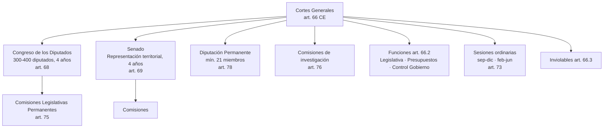

# Esquema: Cortes Generales

## Notas clave
- **Composición**: Congreso + Senado (art. 66.1). Nadie puede ser miembro de ambas Cámaras (art. 67.1).
- **Funciones**: potestad legislativa, aprobación de Presupuestos, control del Gobierno (art. 66.2).
- **Mandato imperativo**: los parlamentarios no están ligados por mandato imperativo (art. 67.2).
- **Diputación Permanente**: mínimo 21 miembros; continúa tras disolución o expiración del mandato hasta la constitución de las nuevas Cortes (art. 78.3).
- **Sesiones**: dos períodos ordinarios (septiembre-diciembre y febrero-junio); extraordinarias a petición (art. 73).
- **Inmunidad/inviolabilidad**: inviolabilidad por opiniones (art. 71.1); inmunidad durante el mandato (art. 71.2).
