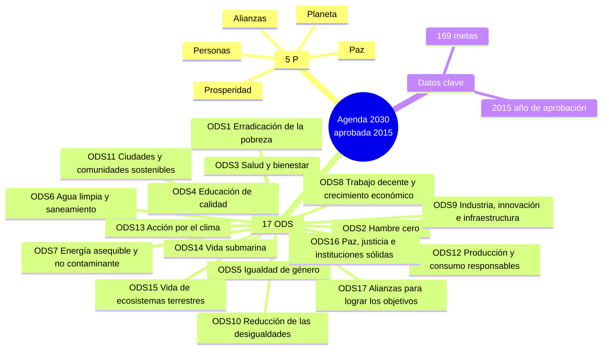

# Esquema: Agenda 2030 y Objetivos de Desarrollo Sostenible (ODS)

## Notas clave
- **Agenda 2030**: plan de acción a favor de las personas, el planeta, la prosperidad, la paz y las alianzas (5 P).
- **17 ODS** y **169 metas**.
- **ODS 1**: Erradicación de la pobreza (no confundir con "lucha contra el hambre", que es ODS 2).
- **NO es ODS oficial**: "Aguas residuales y saneamiento" (el oficial es "Agua limpia y saneamiento", ODS 6).
- Aprobada en 2015 (Resolución 70/1 de la ONU).
