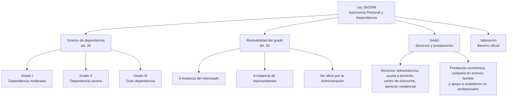

# Esquema: Dependencia y SAAD (Ley 39/2006)

## Notas clave
- **Grado I (moderada)**: necesita ayuda para varias ABVD al menos una vez al día o apoyo intermitente/limitado.
- **Grado II (severa)**: necesita ayuda dos o tres veces al día, sin apoyo permanente de cuidador, o apoyo extenso.
- **Grado III (gran dependencia)**: necesita ayuda varias veces al día y apoyo indispensable y continuo de otra persona.
- **Revisabilidad**: el grado es revisable a instancia del interesado, de sus representantes o de oficio (art. 30).
- **SAAD**: sistema de servicios y prestaciones para la autonomía y atención a la dependencia.