# Esquema: Igualdad efectiva entre mujeres y hombres (LO 3/2007)

```mermaid
flowchart TD
    A[LO 3/2007<br/>Igualdad efectiva] --> B[Principio de igualdad de trato]
    B --> C[Discriminación directa]
    B --> D[Discriminación indirecta]
    B --> E[Acoso sexual]
    B --> F[Acoso por razón de sexo]
    B --> G[Discriminación por embarazo/maternidad<br/>art. 8 → directa]
    B --> H[Indemnidad frente a represalias<br/>art. 9]
    A --> I[Composición equilibrada<br/>40% - 60%]
    A --> J[Planes de igualdad]
    J --> J1[Obligatorios: empresas ≥50 trabajadores<br/>art. 45-46]
    J --> J2[Voluntarios: fomento PYMES + apoyo técnico<br/>art. 49]
    J --> J3[Distintivo empresarial<br/>art. 50]
    A --> K[Criterios AA.PP.<br/>art. 51]
    K --> K1[Remover obstáculos]
    K --> K2[Conciliación]
    K --> K3[Formación en igualdad]
    K --> K4[Presencia equilibrada en órganos de selección]
    K --> K5[Protección frente al acoso]
    K --> K6[Eliminar discriminación retributiva]
    K --> K7[Evaluación periódica]
```

## Notas clave
- **Composición equilibrada**: personas de cada sexo no superan el 60% ni son menos del 40% (disp. adic. 1.ª).
- **Discriminación por embarazo o maternidad** constituye discriminación directa por razón de sexo (art. 8).
- **Represalias** (art. 9): cualquier trato adverso por presentar queja/reclamación/denuncia/demanda/recurso se considera discriminación por razón de sexo.
- **Planes de igualdad**: obligatorios en empresas de 50+ trabajadores (art. 45); voluntarios con medidas de fomento para PYMES (art. 49).
- **Criterios de las Administraciones públicas** (art. 51): incluyen eliminar la discriminación retributiva directa o indirecta por razón de sexo.