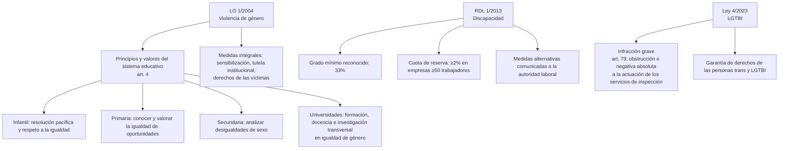

# Esquema: Violencia de género, discapacidad y LGTBI

## Notas clave
- **Violencia de género (LO 1/2004)**: en las universidades se incluirá y fomentará en todos los ámbitos académicos la formación, la docencia y la investigación en igualdad de género y no discriminación de forma transversal (art. 4).
- **Discapacidad (RDL 1/2013)**: se considera persona con discapacidad a partir de un grado mínimo del 33% (art. 4.2).
- **Cuota de reserva**: al menos el 2% de la plantilla en empresas de 50 o más trabajadores; posibilidad de medidas alternativas (art. 42).
- **LGTBI (Ley 4/2023)**: se califica como infracción grave la obstrucción o negativa absoluta a la actuación de los servicios de inspección (art. 79).