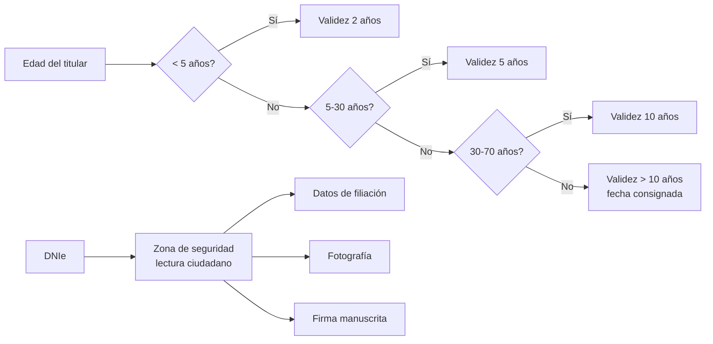

# Esquema: DNIe: validez y zona de seguridad



## Notas clave
- **Validez DNI**: <5 años → 2; 5-30 → 5; 30-70 → 10; >70 → más de 10 (fecha consignada).
- **Certificados DNIe v3.0**: validez de 24 meses.
- **Legislación**: certificados electrónicos reconocidos del DNI no superarán 4 años (RD 1553/2005 mod. RD 414/2015).
```
