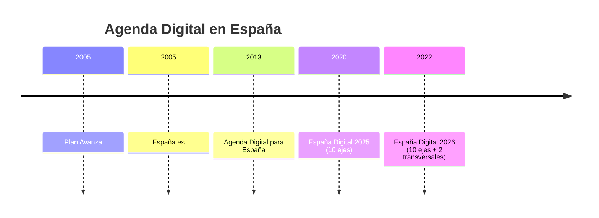

# Esquema: Evolución de la Agenda Digital en España



## Notas clave
- **Plan Avanza**: primera iniciativa para el desarrollo de la Sociedad de la Información.
- **España Digital 2025/2026**: 10 ejes estratégicos; la edición 2026 añade 2 ejes transversales.
- **Ley 56/2007**: factura electrónica obligatoria en la contratación pública, con autenticidad del origen e integridad del contenido.
```
