# Esquema: Derechos digitales (Título X LOPDGDD)

```mermaid
flowchart TD
    T[Título X LOPDGDD] --> A[Acceso y neutralidad]
    A --> A1[Neutralidad Internet art. 80]
    A --> A2[Acceso universal art. 81]
    A --> A3[Seguridad digital art. 82]
    T --> E[Educación y menores]
    E --> E1[Educación digital art. 83]
    E --> E2[Protección de menores art. 84 y 92]
    T --> I[Intimidad y trabajo]
    I --> I1[Intimidad dispositivos art. 87]
    I --> I2[Desconexión digital art. 88]
    I --> I3[Videovigilancia art. 89]
    I --> I4[Geolocalización art. 90]
    T --> R[Rectificación y actualización]
    R --> R1[Rectificación Internet art. 85]
    R --> R2[Actualización de informaciones art. 86]
    T --> O[Olvido y portabilidad]
    O --> O1[Olvido en búsquedas art. 93]
    O --> O2[Olvido en redes sociales art. 94]
    O --> O3[Portabilidad en redes sociales art. 95]
    T --> X[Testamento digital art. 96]
    T --> G[Garantía general art. 79]
```



## Notas clave
- **Art. 79**: los derechos y libertades consagrados en la Constitución y en los Tratados son plenamente aplicables en Internet.
- **Desconexión digital (art. 88)**: derecho a la desconexión fuera del tiempo de trabajo para respetar descanso e intimidad.
- **Testamento digital (art. 96)**: familiares/herederos/albacea pueden acceder a contenidos digitales del fallecido y cumplir sus instrucciones.
```