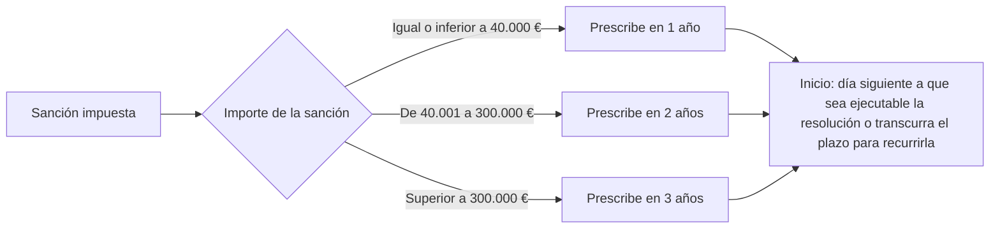

# Esquema: Prescripción de sanciones LOPDGDD



## Notas clave
- **Art. 78 LOPDGDD**: la prescripción de las sanciones se determina por el importe de la sanción impuesta.
- **Art. 75 LOPDGDD**: la iniciación del procedimiento sancionador con conocimiento del interesado interrumpe la prescripción.
- Las infracciones prescriben por separado según su gravedad (muy graves 3 años, graves 2 años, leves 1 año) conforme al régimen general de la Ley 40/2015.
```