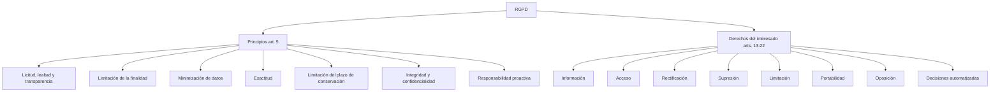

# Esquema: Principios y derechos del RGPD



## Notas clave
- **Minimización de datos (art. 5.1.c)**: los datos serán adecuados, pertinentes y limitados a lo necesario en relación con los fines para los que se tratan.
- **Portabilidad (art. 20)**: derecho a recibir los datos en formato estructurado, de uso común y lectura mecánica y a transmitirlos a otro responsable.
- **Responsabilidad proactiva (art. 5.2)**: el responsable debe poder demostrar el cumplimiento de los principios.
```