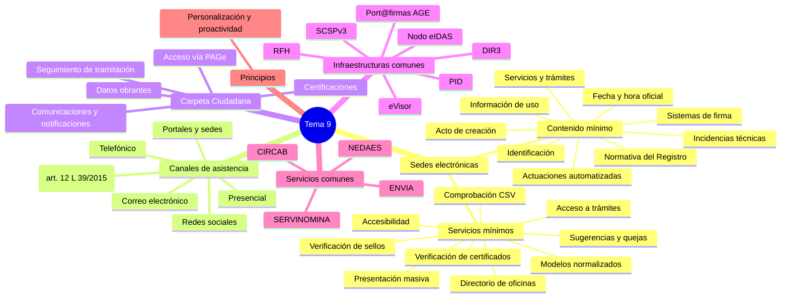

# Esquema: Mapa mental del Tema 9

## Notas clave
- **RD 203/2021**: reglamento de actuación y funcionamiento del sector público por medios electrónicos.
- **Art. 11**: contenido mínimo (11.1 a-i) y servicios (11.2 a-i) de las sedes electrónicas.
- **Art. 4**: canales de asistencia para el acceso a los servicios electrónicos.
- **Art. 2.f**: personalización y proactividad = servicios precumplimentados y anticipación a necesidades.
- **Art. 8**: Carpeta Ciudadana del sector público estatal, accesible vía PAGe.
- **Art. 31**: Registro de Funcionarios Habilitados (RFH), interoperable con CC.AA. y entidades locales.
