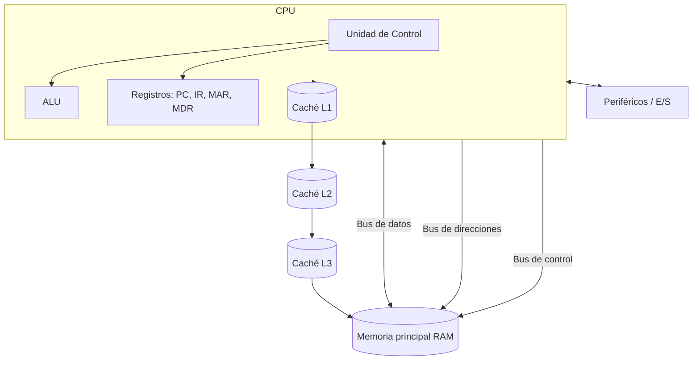

# Esquema: Arquitectura de un ordenador

## Notas clave
- **ALU**: operaciones aritméticas y lógicas; parte de la CPU.
- **Unidad de Control**: decodifica instrucciones y coordina.
- **IR**: instrucción en ejecución; **PC**: siguiente instrucción.
- **Buses**: datos, direcciones y control.
- **Caché**: L1 (en núcleo, más rápida/menor), L2, L3 (compartida).
- **Harvard**: memorias/buses separados para instrucciones y datos.
- **CISC vs RISC**: instrucciones complejas vs simples; **ARM**: RISC de bajo consumo.
- **Taxonomía de Flynn**: SISD, SIMD, MISD, MIMD.
