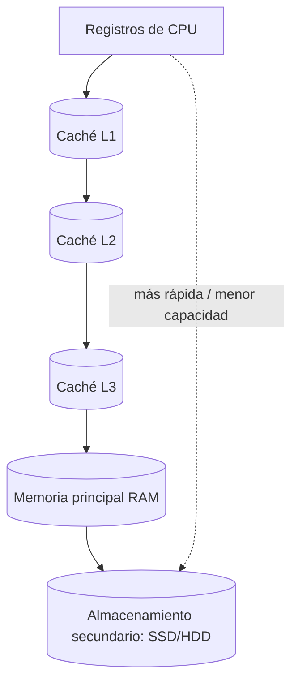

# Esquema: Jerarquía de memoria

## Notas clave
- **Registros**: más rápidos, dentro de la CPU, capacidad mínima.
- **Caché L1**: integrada en el núcleo, más rápida, menor capacidad.
- **Caché L2/L3**: mayor capacidad, algo más lentas.
- **RAM**: memoria principal volátil.
- **Almacenamiento secundario**: persistente, mayor capacidad, más lento.
- **Placa base**: socket CPU, chipset, BIOS/UEFI, ranuras DIMM, PCIe, puertos E/S, batería CMOS.
