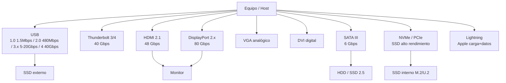

# Esquema: Conectividad de periféricos



## Notas clave
- **USB4** alcanza 40 Gbps; **Thunderbolt 3/4** también 40 Gbps.
- **HDMI 2.1** ofrece hasta 48 Gbps de ancho de banda.
- **DisplayPort 2.x** hasta 80 Gbps.
- **Lightning** es el conector creado por Apple para carga y datos.
- **IDE/PATA** NO es una interfaz válida para SSD modernos.
- **NVMe** es el protocolo de alto rendimiento para SSD sobre PCIe.
```