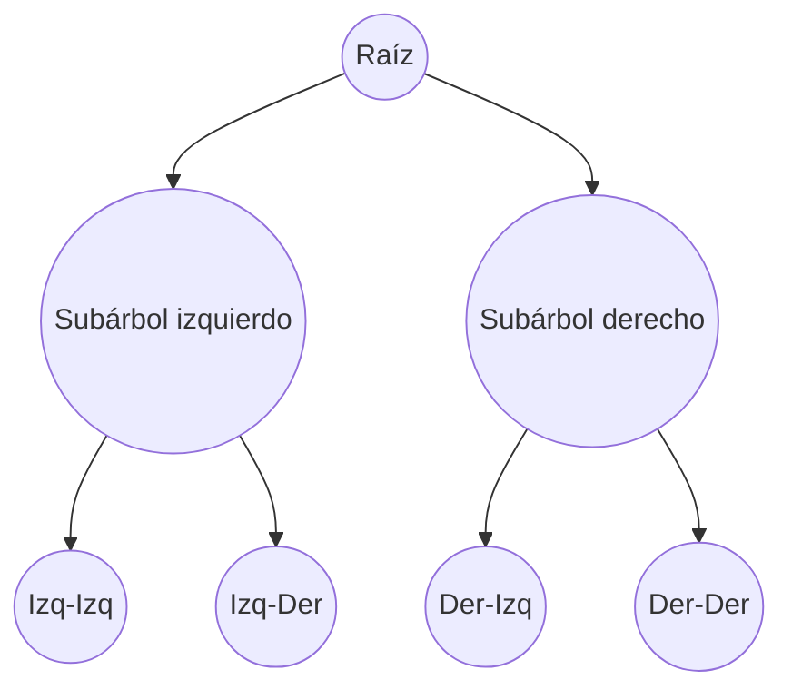

# Esquema: Árboles binarios y recorridos

## Notas clave
- **Árbol binario**: cada nodo tiene como máximo 2 hijos (izquierdo/derecho).
- **Perfecto**: todos los niveles llenos; nodos = 2^h - 1 (raíz nivel 1). Con 4 niveles → 15 nodos.
- **Completo**: todos los niveles llenos salvo el último, que se llena de izquierda a derecha.
- **Lleno (full)**: cada nodo tiene 0 o 2 hijos.
- **Recorrido preorden**: raíz → izquierdo → derecho.
- **Recorrido inorden**: izquierdo → raíz → derecho.
- **Recorrido postorden**: izquierdo → derecho → raíz.
- **Recorrido por niveles (BFS)**: por anchura, usando cola.
- **Árbol 2-3-4**: árbol B de orden 4 (2-4 hijos, 1-3 claves por nodo).
- **Árbol rojo-negro**: BST balanceado; raíz negra, rojos no adyacentes, caminos negros iguales.
- **Grado de un árbol binario**: máximo número de hijos por nodo = 2.
