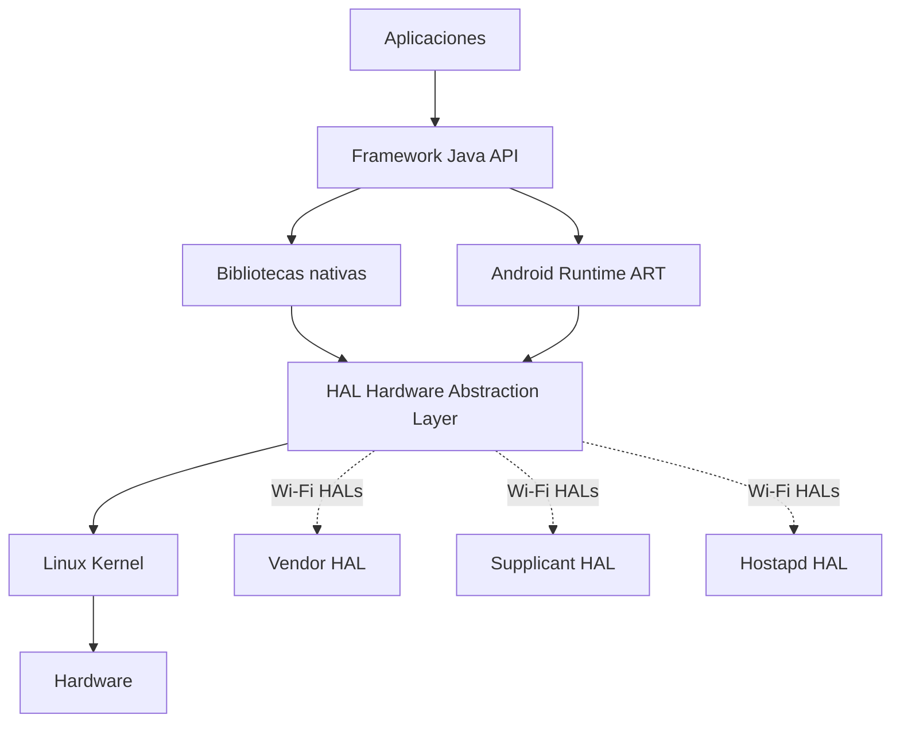

# Esquema: Arquitectura en capas de Android

## Notas clave
- Android se basa en el **kernel de Linux**.
- **ART** ejecuta aplicaciones a partir de bytecode `.dex`.
- **HAL** abstrae el hardware; en Wi-Fi (Android 14+) destacan Vendor, Supplicant y Hostapd HAL.
- **Android NDK** permite desarrollar en C/C++ nativo, pero no sustituye al SDK.
- Las versiones de Android se identifican por nombre en clave y nivel API (Pie = Android 9, API 28).
