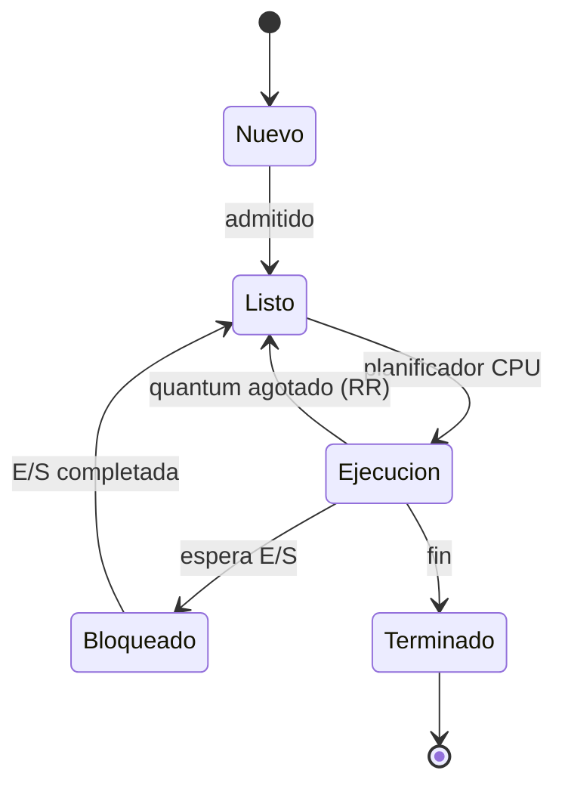

# Esquema: Estados de un proceso y planificacion

## Notas clave
- **PCB (Process Control Block)**: estructura de datos que contiene la informacion de un proceso.
- **Planificador a corto plazo (CPU scheduler)**: decide que proceso entra en la CPU.
- **Round Robin**: asigna un quantum de tiempo de CPU a cada proceso.
- **Hilos (threads)**: permiten ejecucion concurrente dentro de un mismo proceso.
- Estados tipicos: nuevo, listo, ejecucion, bloqueado y terminado.
