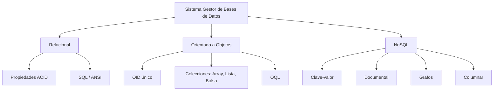

# Esquema: Clasificación de SGBD

## Notas clave
- **Relacional**: tablas, SQL, propiedades ACID, niveles de aislamiento.
- **Orientado a objetos**: objetos con OID, herencia, colecciones; OQL como lenguaje de consulta; ejemplo de SGBDOO: Matisse.
- **NoSQL**: modelos no relacionales; tipos clave-valor, documental, grafos y columnar; ejemplos: Redis, MongoDB, JanusGraph, HBase.
- **Oracle**: tablespace (lógico), datafile (físico), segmento, extensión.
