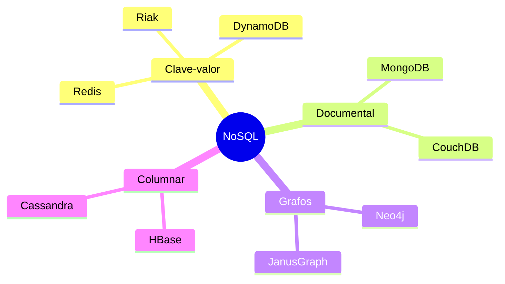

# Esquema: Tipos de bases de datos NoSQL

## Notas clave
- **Clave-valor**: pares clave-valor; alto rendimiento en caché y sesiones.
- **Documental**: documentos JSON/BSON; flexible para catálogos y perfiles.
- **Grafos**: nodos y aristas; redes sociales y recomendaciones (JanusGraph es grafo).
- **Columnar**: familias de columnas; analítica y series temporales.
- Aurora es relacional (no NoSQL); HBase/CouchDB sí son NoSQL.
