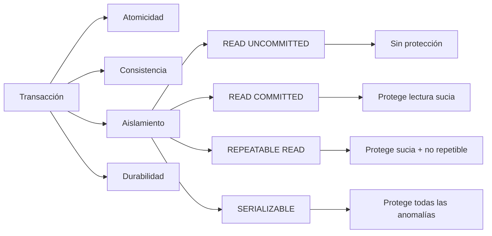

# Esquema: Transacciones y niveles de aislamiento

## Notas clave
- **ACID**: Atomicidad, Consistencia, Aislamiento, Durabilidad.
- **READ UNCOMMITTED**: no protege ninguna anomalía.
- **READ COMMITTED**: protege lectura sucia.
- **REPEATABLE READ**: protege lectura sucia y no repetible, no la fantasma.
- **SERIALIZABLE**: máximo aislamiento, protege todas las anomalías.
