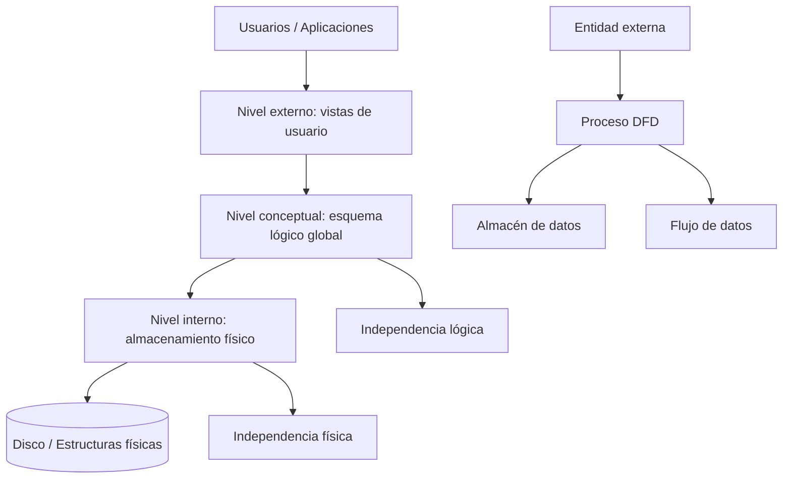

# Esquema: Arquitectura ANSI/SPARC y DFD (Métrica v3)

## Notas clave
- **ANSI/SPARC** define tres niveles de abstracción: externo (vistas), conceptual (esquema global) e interno (físico).
- **Independencia física**: cambios en el almacenamiento no afectan al esquema conceptual.
- **Independencia lógica**: cambios en el esquema conceptual no afectan a las vistas/programas.
- **DFD (Métrica v3)**: procesos, almacenes de datos, entidades externas y flujos de datos.
- En la **explosión** de un DFD debe mantenerse el **equilibrio** (balance) y la **conservación** de datos.
