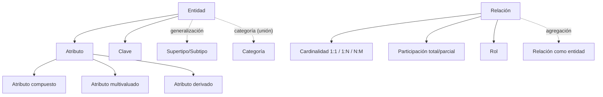

# Esquema: Modelo Entidad/Relación Extendido (Métrica v3)

## Notas clave
- **Entidad**: conjunto de objetos del dominio con propiedades comunes; se representa con rectángulo.
- **Relación**: asociación entre entidades; rombo. Se define por nombre, tipo, cardinalidad y participación.
- **Cardinalidad**: número de instancias asociadas (1:1, 1:N, N:M).
- **Participación**: total (obligatoria, línea doble) o parcial (opcional).
- **Atributo derivado**: elipse discontinua; su valor se calcula, no se almacena.
- **Categoría (unión)**: relaciona entidades de dominios independientes que coyunturalmente se asocian.
- **Agregación**: trata una relación como entidad para que participe en otra relación.
