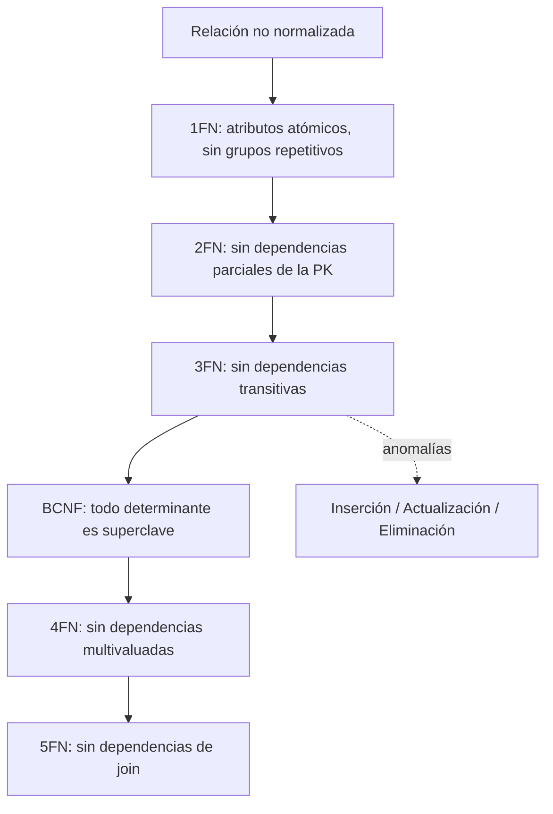

# Esquema: Normalización de bases de datos relacionales

## Notas clave
- **1FN**: elimina grupos repetitivos; todos los valores son atómicos.
- **2FN**: elimina dependencias parciales cuando la PK es compuesta.
- **3FN**: elimina dependencias transitivas; todo atributo no clave depende directamente de la PK.
- **BCNF**: refuerza la 3FN exigiendo que todo determinante sea superclave.
- **4FN/5FN**: tratan dependencias multivaluadas y de join.
- Una relación con **descomposición sin pérdida** (lossless join) puede reconstruirse sin pérdida de información a partir de la join de sus proyecciones.
