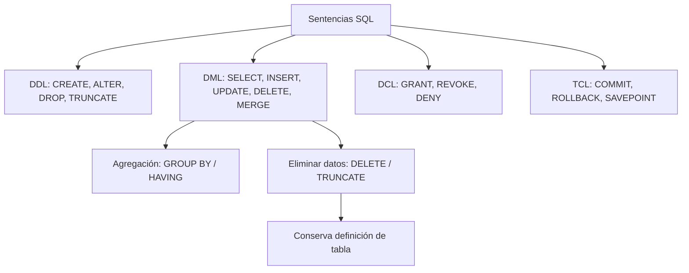

# Esquema: Tipología SQL y operaciones de datos



## Notas clave
- **DDL**: define estructura; DROP elimina objeto y estructura; TRUNCATE vacía tabla rápidamente.
- **DML**: manipula datos; DELETE permite WHERE y rollback; TRUNCATE es DDL en muchos SGBD.
- **DCL**: control de acceso; DENY (Transact-SQL) deniega permisos.
- **TCL**: transacciones; ROLLBACK revierte; SAVEPOINT marca punto de recuperación.
- **GROUP BY** agrupa filas; **HAVING** filtra grupos (ej. más de 10 personas por lugar: `GROUP BY lugar HAVING COUNT(*) > 10`).
- **Oracle INSTR('Corporate Floor','or',3,2)** devuelve **14**.
- Lenguajes de consulta: **OQL** (bases de datos orientadas a objetos, estándar ODMG) y **Cypher** (Neo4j, bases de datos de grafos).
```