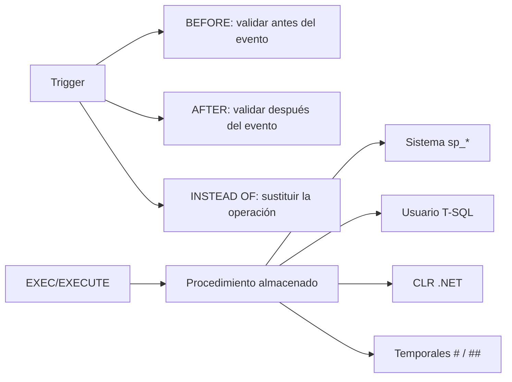

# Esquema: Triggers y procedimientos almacenados



## Notas clave
- **ANSI SQL**: `CREATE TRIGGER ... {BEFORE|AFTER} {INSERT|UPDATE|DELETE} ON tabla [FOR EACH ROW|STATEMENT]`.
- Validar cambio antes del evento: trigger **BEFORE** (ej. sobre `Departamento`).
- Cambio de valor de columna: `BEFORE UPDATE OF Salario ON Empleados`.
- **SQL Server**: triggers DML `AFTER (FOR)` e `INSTEAD OF`; además DDL triggers y logon triggers.
- Ejecución en SQL Server: **EXEC/EXECUTE** (posicionales o nombrados); `CALL` es estándar ANSI y no se usa en T-SQL.
- Tipos de procedimientos en SQL Server: sistema, usuario, CLR y temporales.
```