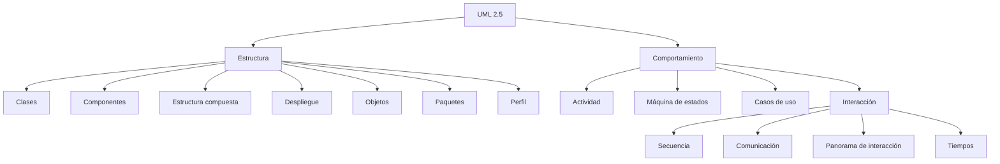

# Esquema: Diagramas UML 2.5



## Notas clave
- **Diagramas de estructura** (7): Clases, Componentes, Estructura compuesta, Despliegue, Objetos, Paquetes, Perfil.
- **Diagramas de comportamiento** (4 + 4 de interacción): Actividad, Máquina de estados, Casos de uso e Interacción (Secuencia, Comunicación, Panorama, Tiempos).
- El **diagrama de secuencia** representa la interacción entre objetos/participantes mediante los mensajes que se intercambian; describe en detalle un escenario de un caso de uso (Métrica v3).
- Visibilidad UML: `+` público, `-` privado, `#` protegido, `~` paquete.
```

>