# Esquema: Patrones de diseño GoF (Gang of Four)

```mermaid
flowchart TD
    GOF[Patrones GoF] --> C[Creacionales]
    GOF --> E[Estructurales]
    GOF --> B[Comportamiento]
    C --> C1[Abstract Factory]
    C --> C2[Builder]
    C --> C3[Factory Method]
    C --> C4[Prototype]
    C --> C5[Singleton]
    E --> E1[Adapter]
    E --> E2[Bridge]
    E --> E3[Composite]
    E --> E4[Decorator]
    E --> E5[Facade]
    E --> E6[Flyweight]
    E --> E7[Proxy]
    B --> B1[Chain of Responsibility]
    B --> B2[Command]
    B --> B3[Interpreter]
    B --> B4[Iterator]
    B --> B5[Mediator]
    B --> B6[Memento]
    B --> B7[Observer]
    B --> B8[State]
    B --> B9[Strategy]
    B --> B10[Template Method]
    B --> B11[Visitor]
```



## Notas clave
- **Factory Method vs Abstract Factory**: Factory Method delega la creación de un producto en subclases; Abstract Factory crea familias de productos relacionados.
- **Decorator**: añade responsabilidades a un objeto dinámicamente, alternativa flexible a la herencia.
- **Composite**: compone objetos en árboles parte-todo con tratamiento uniforme de hojas y compuestos.
- **Observer**: notifica automáticamente a múltiples observadores sobre cambios de estado del sujeto (acoplamiento débil).
- Total: 23 patrones (5 creacionales + 7 estructurales + 11 de comportamiento).
```

