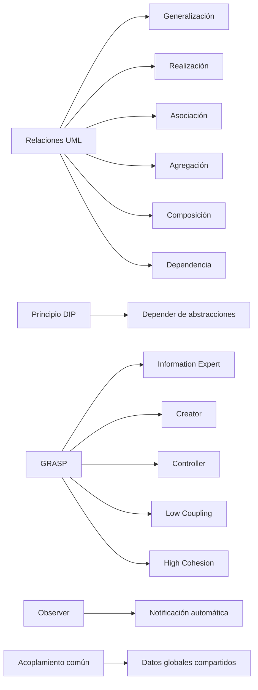

# Esquema: Relaciones, acoplamiento y principios de diseño OO



## Notas clave
- **Composición** (rombo relleno): relación jerárquica totalidad-partes; las partes no existen sin el todo (Métrica v3).
- **Agregación** (rombo hueco): todo-parte débil; las partes pueden existir independientemente.
- **Acoplamiento común**: varios módulos comparten una estructura global de datos.
- **DIP**: las clases de alto nivel no dependen de las de bajo nivel; ambas dependen de abstracciones.
- **GRASP**: patrones generales de asignación de responsabilidades (Information Expert, Creator, Controller, Low Coupling, High Cohesion, Polymorphism, Pure Fabrication, Indirection, Protected Variations).
- **Observer**: notifica automáticamente a múltiples objetos sobre cambios de estado de un sujeto (acoplamiento débil).
- Características del modelo OO: encapsulación, herencia, polimorfismo y abstracción.
```

