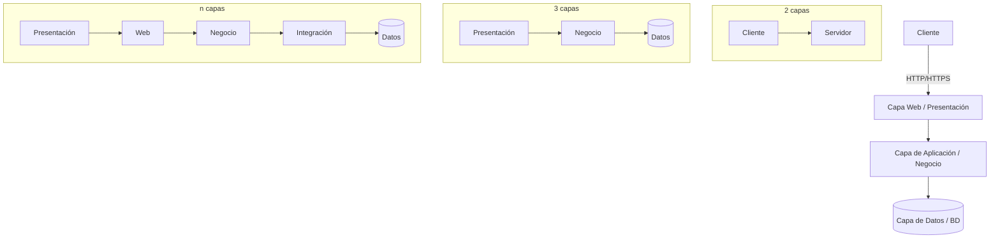

# Esquema: Arquitectura cliente/servidor y multicapas

## Notas clave
- **Cliente/servidor**: el cliente solicita servicios; el servidor los proporciona.
- **2 capas**: cliente + servidor; lógica repartida; acoplamiento alto.
- **3 capas**: separación presentación / negocio / datos; escalabilidad.
- **n capas (multicapas)**: especialización por capas; balanceo y caché.
- **Sistemas distribuidos**: escalabilidad, transparencia, heterogeneidad y tolerancia a fallos.
