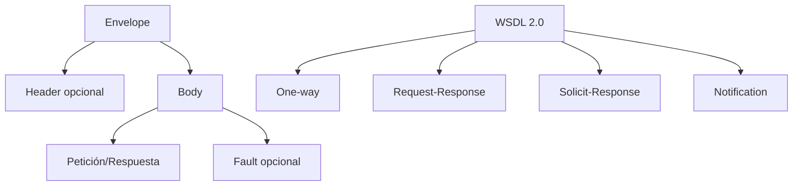

# Esquema: Mensaje SOAP y operaciones WSDL

## Notas clave
- **Envelope**: elemento raíz obligatorio del mensaje SOAP.
- **Header**: metadatos opcionales (seguridad, transacciones).
- **Body**: carga útil obligatoria.
- **Fault**: error dentro del Body.
- **WSDL 2.0**: lenguaje XML para describir servicios web a partir de un modelo abstracto.
- **SOAP última versión**: 1.2.
