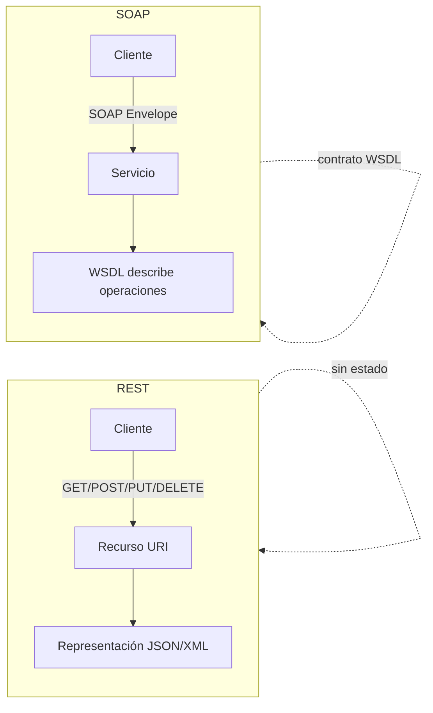

# Esquema: Servicios web REST vs SOAP

## Notas clave
- **REST**: arquitectura orientada a recursos; usa métodos HTTP; sin estado; representaciones JSON/XML.
- **SOAP**: protocolo de mensajería XML (Envelope/Header/Body); versión actual 1.2.
- **WSDL**: describe el servicio (operaciones one-way, request-response, solicit-response, notification).
- **WSIL**: método alternativo de descubrimiento de servicios web.
- **UDDI**: registro para publicar/buscar servicios (no usado por REST).
- **OASIS**: WS-SecureConversation establece y comparte contextos de seguridad.
