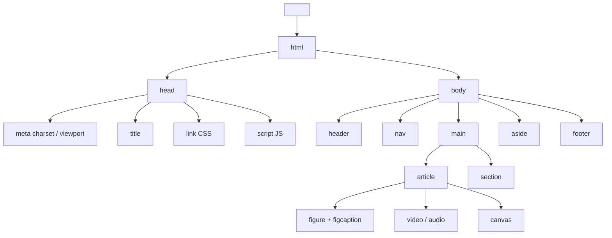

# Esquema: Estructura de un documento HTML5

## Notas clave
- **DOCTYPE** debe ser la primera línea del documento (HTML Living Standard WHATWG).
- **Semántica**: header, nav, main, article, section, aside, footer mejoran accesibilidad y SEO.
- **Multimedia nativa**: video, audio, canvas sin plugins externos.
- **Formularios**: datalist, output, progress, meter.
- **HTML vs XHTML**: HTML es SGML y más permisivo; XHTML es XML estricto (etiquetas en minúsculas, cerradas, atributos entre comillas).
