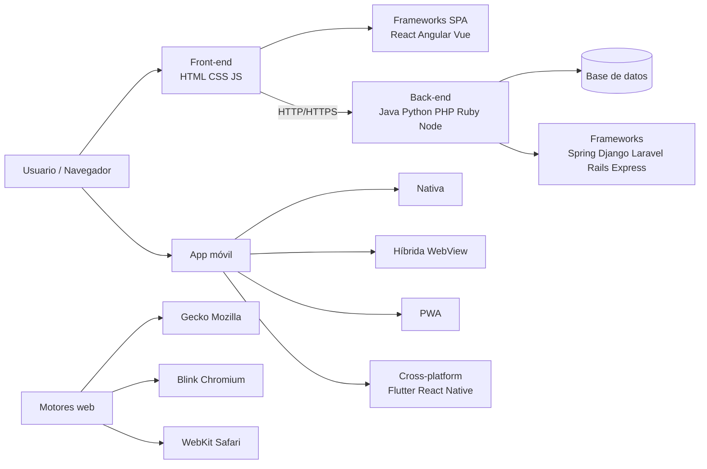

# Esquema: Stack web Front-end / Back-end y opciones móviles

## Notas clave
- **Front-end**: HTML, CSS, JavaScript; frameworks SPA React/Angular/Vue.
- **Back-end**: Java, Python, PHP, Ruby, Node.js; frameworks Spring, Django, Laravel, Rails, Express.
- **Ruby on Rails**: framework MVC para Ruby en servidor.
- **JavaScript**: ECMAScript, débilmente tipado, orientado a prototipos, single-threaded con event loop; runtime servidor Node.js.
- **NO es framework JS**: Django, Laravel, Spring, Rails (back-end).
- **Motor Mozilla**: Gecko.
- **Apps móviles**: nativa, híbrida, PWA, cross-platform; una app de escritorio NO es opción móvil.
- **CSS3**: unidades relativas (em, rem, %, vw, vh...) vs absolutas (px, cm, pt...).
- **Eventos HTML**: onmouseover/mouseenter para efecto al situar puntero.
