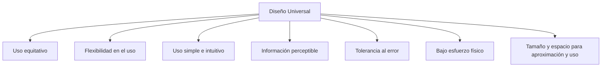

# Esquema: Principios del Diseño Universal

## Notas clave
- El **Diseño Universal** busca crear productos y entornos utilizables por todas las personas, en la mayor medida posible, sin adaptación ni diseño especializado.
- Sus **7 principios** son: Uso equitativo, Flexibilidad en el uso, Uso simple e intuitivo, Información perceptible, Tolerancia al error, Bajo esfuerzo físico, Tamaño y espacio para aproximación y uso.
- **Tolerancia al error**: minimiza los riesgos y las consecuencias adversas de acciones accidentales o involuntarias.
- No confundir con los principios de accesibilidad web (POUR) ni con las heurísticas de usabilidad de Nielsen.
