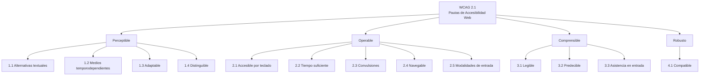

# Esquema: Principios de accesibilidad web (WCAG 2.1) — POUR

## Notas clave
- **WCAG 2.1** organiza la accesibilidad en cuatro principios conocidos por el acrónimo **POUR**: Perceptible, Operable, Comprensible, Robusto.
- El principio **Perceptible** incluye las pautas: Alternativas textuales, Medios temporodependientes, Adaptable y Distinguible.
- **Distinguible**: facilitar a los usuarios ver y oír el contenido, incluyendo la separación entre primer plano y fondo.
- El principio **Operable** incluye la accesibilidad por teclado y la evitación de contenido que pueda provocar convulsiones.
- Niveles de conformidad: **A** (mínimo), **AA** (exigido por la legislación española/europea para el sector público) y **AAA** (máximo).
