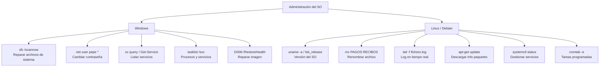

# Esquema: Comandos de administración del SO (Windows vs Linux)

## Notas clave
- **Windows**: `sfc /scannow` repara archivos de sistema protegidos; complementar con `DISM /Online /Cleanup-Image /RestoreHealth`.
- **Cambio de contraseña**: `net user <usuario> *` solicita la nueva contraseña de forma interactiva (requiere privilegios).
- **Servicios en Windows**: `sc query`, `Get-Service` (PowerShell) y `tasklist /svc` muestran servicios/procesos.
- **Linux/Debian**: `uname -a`/`lsb_release -a`/`/etc/os-release` para la versión; `mv` renombra; `tail -f` sigue logs.
- **Paquetes Debian**: `apt-get update` descarga índices (no instala); `apt-get upgrade` actualiza paquetes instalados.
- **Servicios Linux**: gestión con `systemctl`; tareas programadas con `crontab -e`.
