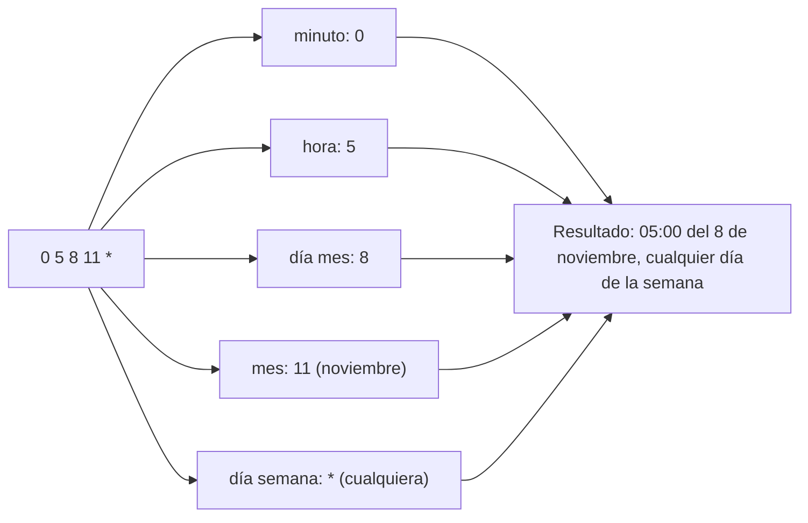

# Esquema: Crontab (formato de tiempo)

## Notas clave
- Formato: `minuto hora día_mes mes día_semana comando`.
- Rangos: minuto 0-59, hora 0-23, día mes 1-31, mes 1-12, día semana 0-7 (0 y 7 = domingo).
- `*` significa "cualquier valor" para ese campo.
- El ejemplo `0 5 8 11 *` se ejecuta a las 05:00 del día 8 de noviembre, todos los días de la semana.
- Edición con `crontab -e`; listado con `crontab -l`.
