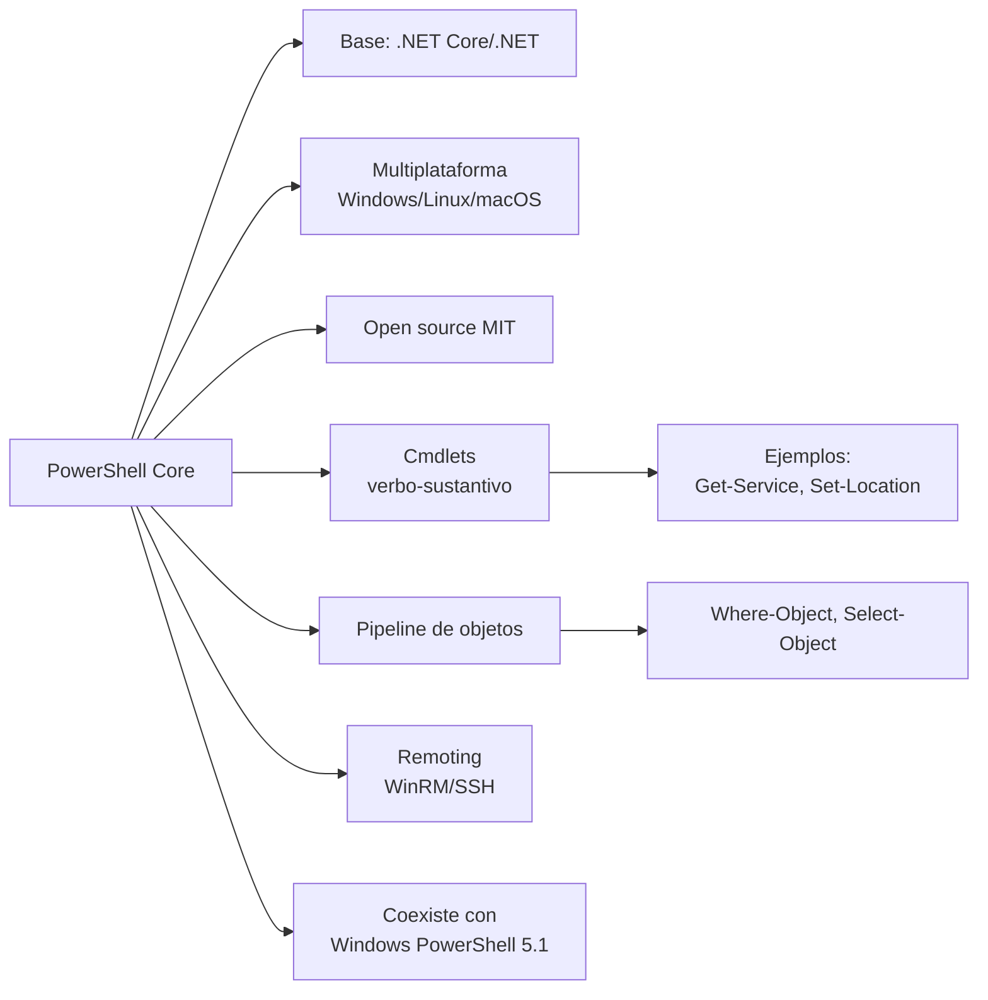

# Esquema: PowerShell Core

## Notas clave
- **PowerShell Core** (6+) es multiplataforma y open source, construido sobre .NET Core/.NET.
- **Cmdlets** usan nomenclatura verbo-sustantivo y operan sobre objetos .NET en el pipeline.
- **Pipeline de objetos** (no texto) permite filtrar/transformar con `Where-Object`, `Select-Object`.
- **Remoting** vía WinRM (Windows) o SSH (Linux/macOS).
- **Windows PowerShell 5.1** (.NET Framework, solo Windows) coexiste pero es edición distinta.
