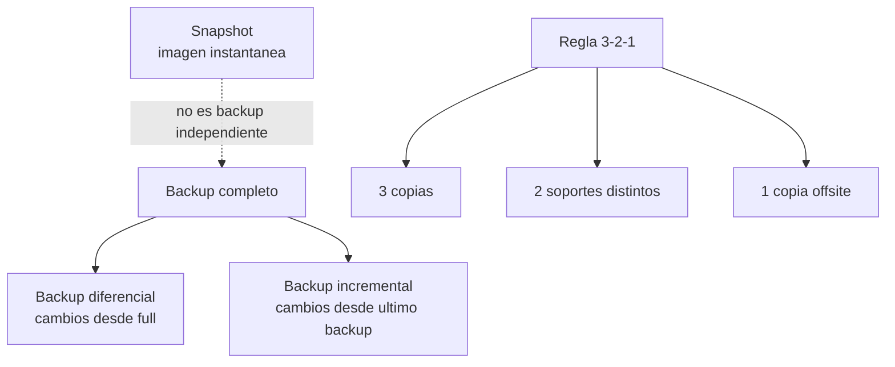

# Esquema: Estrategia de backup y snapshots

## Notas clave
- **Completo**: copia de todos los datos; base de referencia.
- **Diferencial**: cambios desde el ultimo backup completo.
- **Incremental**: cambios desde el ultimo backup (completo o incremental).
- **Snapshot**: imagen puntual (copy-on-write); depende del volumen original; no sustituye al backup.
- **Regla 3-2-1**: 3 copias, en 2 soportes distintos, 1 copia fuera de sitio (offsite).
