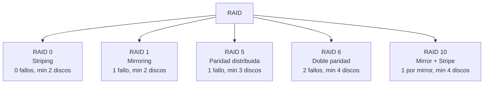

# Esquema: Niveles RAID y tolerancia a fallos

## Notas clave
- **RAID 5**: striping con paridad distribuida; acceso independiente; tolera 1 fallo.
- **RAID 6**: tolera 2 fallos simultaneos gracias a doble paridad.
- **RAID 0**: sin redundancia; mejora rendimiento pero no tolera fallos.
- **RAID 1**: espejo; tolera fallo de un disco (o n-1 en mirror).
- **RAID 10**: combina mirroring y striping; alto rendimiento y redundancia.
