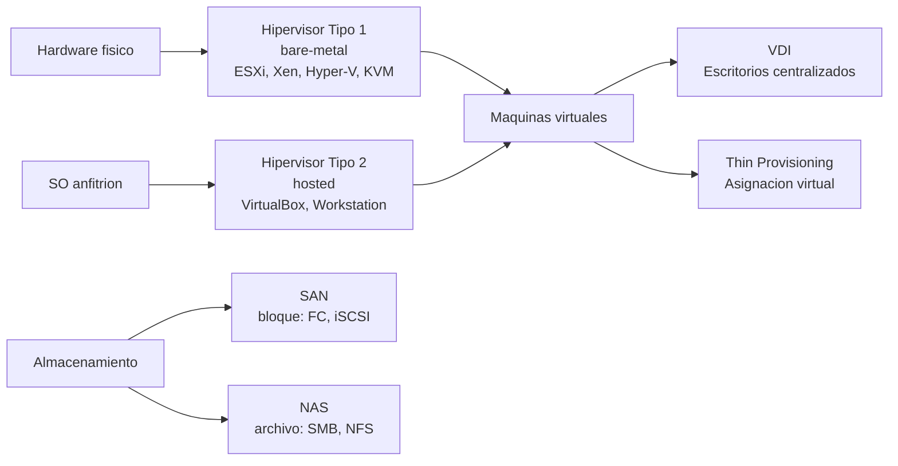

# Esquema: Virtualizacion de sistemas y almacenamiento

## Notas clave
- **Hipervisor tipo 1**: se ejecuta directamente sobre el hardware; mayor rendimiento; usado en servidores.
- **Hipervisor tipo 2**: se ejecuta sobre un SO anfitrion; orientado a escritorio/pruebas.
- **VDI**: centraliza escritorios en el datacenter; acceso remoto mediante thin clients.
- **Thin provisioning**: sobreasigna espacio virtual; reserva bloques fisicos al escribir.
- **SAN**: acceso a nivel de bloque; alto rendimiento; NAS: acceso a nivel de archivo compartido en LAN.
