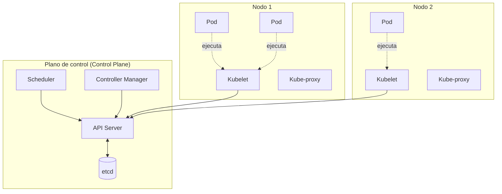

# Esquema: Arquitectura de Kubernetes

## Notas clave
- **Scheduler**: asigna Pods a nodos según recursos disponibles.
- **etcd**: almacenamiento no volátil de toda la configuración del clúster.
- **Kubelet**: agente por nodo que garantiza que los contenedores estén en ejecución.
- **Objetos básicos**: Pod, Service, Volume, Namespace, ConfigMap, Secret.
- **Identificación única**: campo `metadata.name` (+ namespace).
