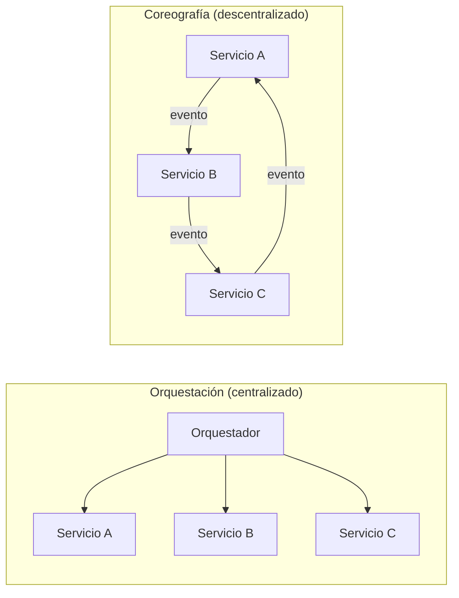

# Esquema: Composición de microservicios

## Notas clave
- **Orquestación**: un controlador central dirige el flujo y las llamadas.
- **Coreografía**: los servicios se coordinan mediante eventos, sin controlador central.
