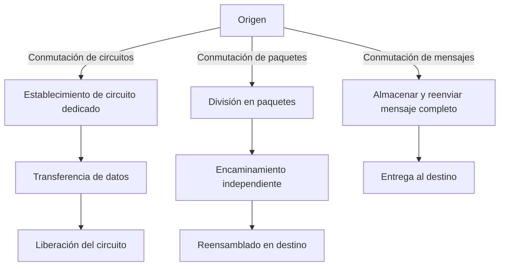

# Esquema: Redes de conmutación

## Notas clave
- **Conmutación de circuitos**: reserva de un canal dedicado end-to-end; retardo constante; ideal para voz (RTC/PSTN).
- **Conmutación de paquetes**: no hay conexión previa; los paquetes se encaminan independientemente; mayor eficiencia; base de Internet (IP).
- **Conmutación de mensajes**: almacena el mensaje completo en cada nodo y lo reenvía; retardo alto; usado en correo y telegrafía.
- En paquetes puede haber reordenación y jitter; se compensa con buffers y protocolos de transporte (TCP/UDP).
