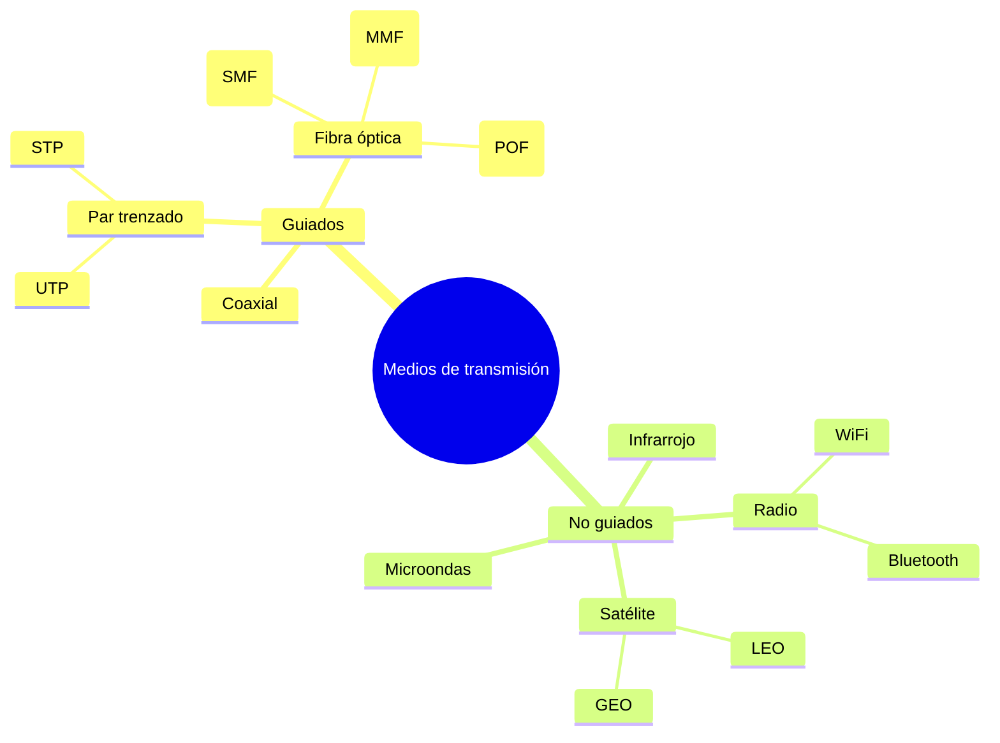

# Esquema: Medios de transmisión

## Notas clave
- **Medios guiados**: la señal viaja por un conductor físico (cobre o fibra).
- **Medios no guiados**: propagación por el aire/espacio (radio, microondas, satélite, infrarrojo).
- **Fibra óptica plástica (POF)**: núcleo de polímero, bajo coste y fácil instalación, distancias cortas (50-100 m), hasta 1 Gbps.
- **Monomodo**: un solo modo de propagación, larga distancia; **multimodo**: varios modos, distancias cortas, conectores más baratos.
- La atenuación y el ancho de banda determinan la elección del medio.
