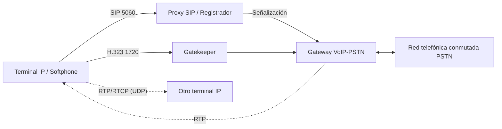

# Esquema: Telefonía IP (VoIP)

## Notas clave
- **SIP** (Session Initiation Protocol): señalización de sesiones multimedia; por defecto puerto **5060** (UDP/TCP), **5061** con TLS.
- **H.323**: estándar ITU para multimedia; **H.245** describe el control de llamadas/capacidades; señalización H.225/Q.931 en puerto 1720.
- **RTP**: transporte de medios (voz/vídeo) sobre UDP en rango dinámico; **RTCP** aporta control y calidad (puerto RTP+1).
- **VPLS** (Virtual Private LAN Service): servicio VPN de nivel 2 (Ethernet) que emula una LAN sobre una red MPLS, conectando múltiples sitios como si fueran una misma LAN.
- Protocolos sin relación directa con telefonía IP: típicamente los de enrutamiento genérico (p. ej. RIPng para IPv6) o los de otras capas.
