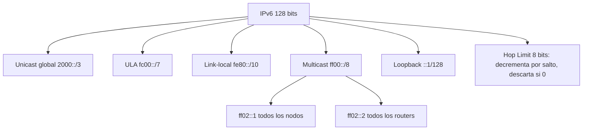

# Esquema: IPv6 y multicast

## Notas clave
- Prefijo multicast IPv6: **ff00::/8** (todo multicast comienza por ff).
- **Hop Limit** (RFC 8200): evita bucles; cada router lo decrementa; paquete descartado al llegar a 0.
- Multicast sustituye broadcast en IPv6.
- Link-local (fe80::/10) para autoconfiguración y descubrimiento de vecinos.
