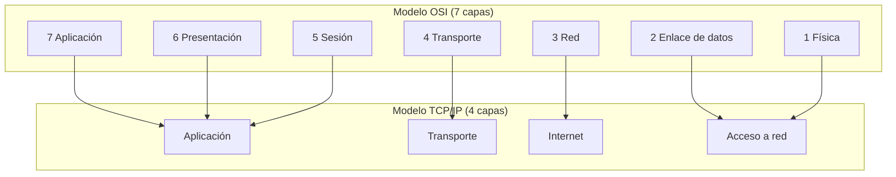

# Esquema: Modelos OSI y TCP/IP

## Notas clave
- **Presentación (capa 6)**: negociación de sintaxis de transferencia y transformaciones de datos (cifrado, compresión).
- **TCP/IP** agrupa las capas 5-7 de OSI en "Aplicación" y las capas 1-2 en "Acceso a red".
- **Transporte**: TCP (fiable, orientado a conexión) y UDP (datagramas, no fiable).
- **Internet**: IP, ICMP, IGMP; direccionamiento lógico y enrutamiento.
