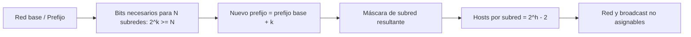

# Esquema: Subnetting IPv4

## Notas clave
- Ejemplo: 10.0.0.0/8 con 600 subredes → k=10 (2^10=1024≥600) → /18 → máscara 255.255.192.0.
- Hosts por subred con /18: 2^14 - 2 = 16382.
- Dirección de red (host todo 0) y broadcast (host todo 1) no asignables a hosts.
- Clase A: 1-126, /8; Clase B: 128-191, /16; Clase C: 192-223, /24.
